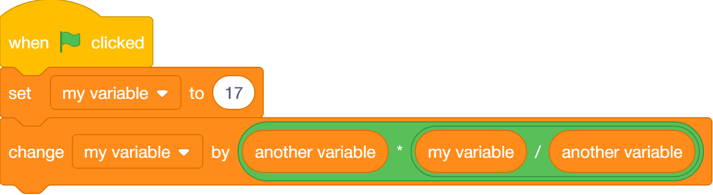
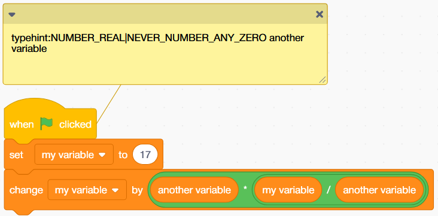
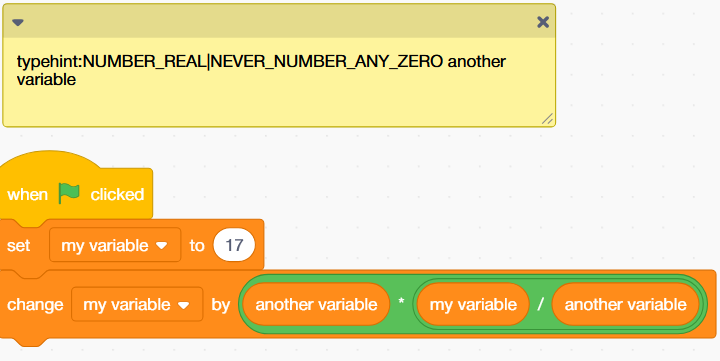
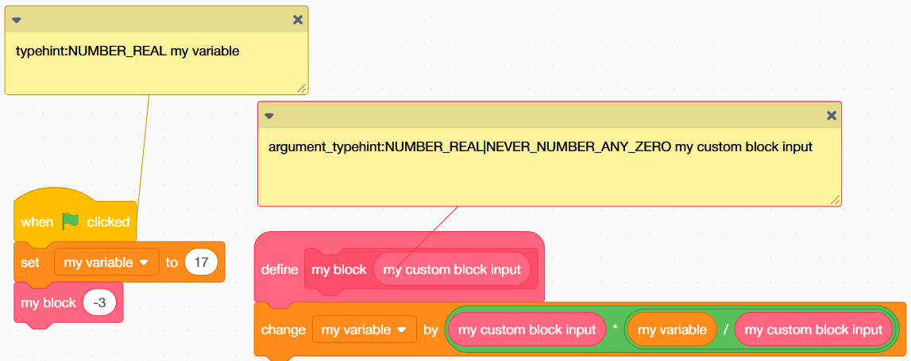

# Type Hints

By default, the compiler will determine the type of a variable based on its usage. However, to maintain compatibility with Scratch, the compiler has to be extremely conservative about its assumptions.
For example, if the left side of a multiplication has a chance of being zero and the right side has a chance of being infinity, one of the possible outputs of this operation is NaN. Before this output can be used in any other operations it must be turned back into a number, so the operation is wrapped in toNotNan().
This is extremely slow, and it usually has to be done after *every* operation. The below script has 3 toNotNaN() calls in the compiled javascript.


Type hinting allows you to explicitly tell the compiler what type a variable will be. The compiler will still make its overly conservative assumptions, but they'll be more accurate due to your hints.

## Hinting variable types per-hat {#hat-hints}

Variable hints are done by adding a comment to the hat of a script in the following format:
```
typehint:TYPE1|TYPE2|TYPE3... variable name
typehint:TYPE2|NEVER_TYPE4|TYPE5... another variable name
```

Where TYPE is a valid internal variable type, which can be found [here](https://github.com/TurboWarp/scratch-vm/blob/develop/src/compiler/enums.js), and the variable name is the name of either a variable or a list. You can also specify that a variable will never be a certain type. Using our example from before, we can add a hint saying that `another variable` will be any positive or negative number, but not any infinity or any zero (Watch out - there's both a positive and negative zero!):
```
typehint:NUMBER_REAL|NEVER_NUMBER_ANY_ZERO another variable
```


This one hint removed all of the toNotNaN() calls from our compiled javascript. But if `another variable` is used elsewhere, it may be cumbersome to redeclare that hint everywhere that it's used. (Luckily type hints are inherited by any custom blocks that are used by the script, so you won't need to redeclare them there)

:::caution
Type hints are case-sensitive! The name of the type and the name of the variable need to match capitalization exactly.
:::

:::warning
By default the type hint for a variable defaults to nothing. This means that if you only have NEVER_TYPE hints, it won't work!
This does nothing: `typehint:NEVER_NUMBER_ANY_ZERO`
Instead do this: `typehint:ANY|NEVER_NUMBER_ANY_ZERO`
:::

## Hinting variable types globally {#global-hints}

You can hint the type of a variable across an entire sprite(but not across the entire project) by adding a comment in the sprite not attached to any blocks:



This functions identically to the previous script, except for the fact that the hint will be shared across all scripts in the sprite.
The compiler doesn't have any way to infer the type of lists, so if you want to do that, a global type hint might be a good idea.

## Hinting custom block input types {#argument-hints}

Similar to lists, the compiler doesn't have any ways to infer the types of custom block inputs. You can use type hinting to accomplish this in a similar manner to the first example:
```
argument_typehint:NUMBER_REAL|NEVER_NUMBER_ANY_ZERO my custom block input
```

```
typxehint:NUMBER_REAL my variable
```



This example also shows how type hints are inherited, with the type for `my variable` being passed to `my block`


## Closing notes {#notes}

As you may have noticed from the type enums page, type hints are a bitfield. When you specify type hints, you perform one of two operations:
 - Traditional hints. `CURRENT_HINT = CURRENT_HINT **OR** TYPE_HINT` where OLD_HINT is the current type hint and TYPE_HINT is one of the enums you can use in a hint.
 - NEVER hints. `CURRENT_HINT = CURRENT_HINT **AND** (**NOT** TYPE_HINT)` where the former still applies.

The compiler will still try to determine the type of variables. However, its final decision is then **AND**'d with the type hint, essentially restricting the possible options that the compiler has:
`VARIABLE_TYPE = VARIABLE_TYPE **AND** CURRENT_HINT`

Type hints pair well with the [relaxed math](./relaxed-math) feature by further reducing the chances of casting occurring.